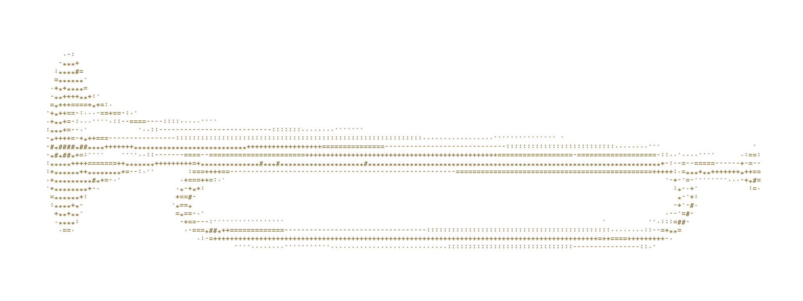
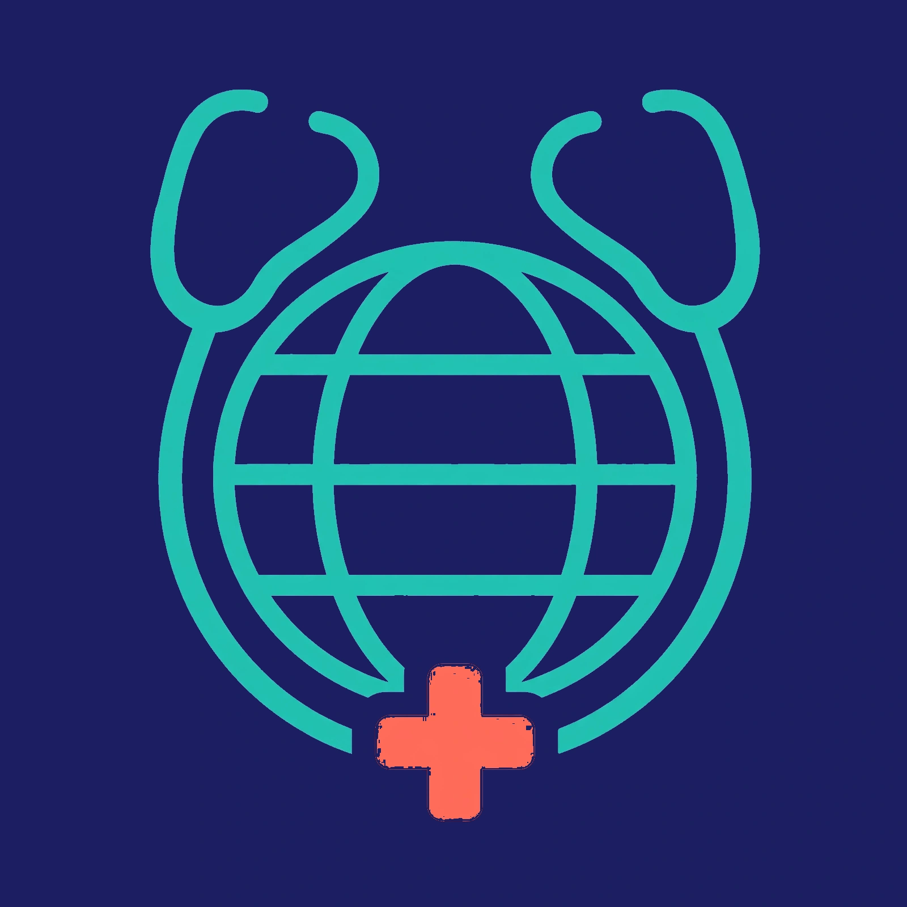
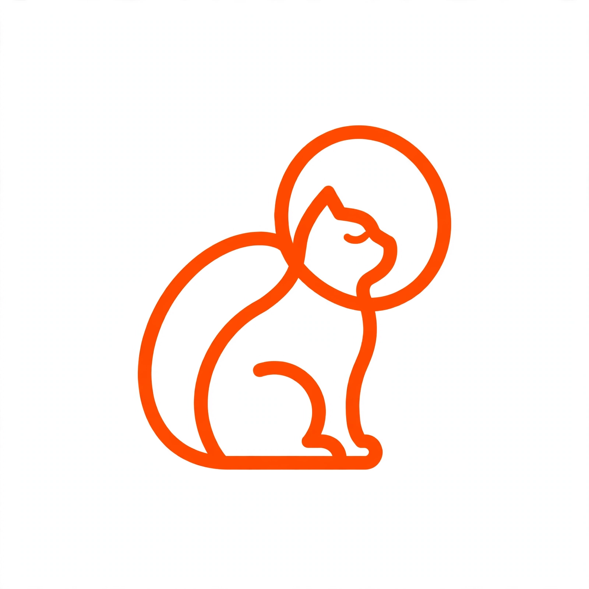

  

  <strong>Indie builder from Bekasi, Indonesia 🇮🇩</strong> 
  I build tools for AI agents — and small web apps with strong design opinions. 
  Everything here is open source (MIT), and most of it installs in one line.

---

<h2 align="center">Works</h2>

One name pinned at the top; the work changes underneath.

<table align="center">
  <tr>
    <td align="center" width="50%">
       
      <strong><a href="https://github.com/neartana/frame-note">FrameNote</a></strong> 
      Your agent can't watch videos — FrameNote teaches it to read them: frame by frame, note by note. 
      <code>npx skills add neartana/frame-note</code>
    </td>
    <td align="center" width="50%">
       
      <strong><a href="https://github.com/neartana/dohctor">Dohctor</a></strong> 
      A DNS doctor for AI agents — diagnose DNS blocking &amp; poisoning, resolve and fetch over DNS-over-HTTPS. Keyless. 
      <code>npx skills add neartana/dohctor</code>
    </td>
  </tr>
  <tr>
    <td align="center" width="50%">
       
      <strong><a href="https://github.com/neartana/Tracenime">Tracenime</a></strong> 
      Point at any anime screenshot — Tracenime names the series, episode and timestamp. Brutalist Kinetic Orange, all data stays in your browser.
    </td>
    <td align="center" width="50%">
       
      <strong><a href="https://github.com/neartana/Anigraph">Anigraph</a></strong> 
      Your anime &amp; manga library, in perspective — statistics, recommendations, tier lists and airing schedules for AniList &amp; MyAnimeList users. 
      <a href="https://anigraph-phi.vercel.app">anigraph-phi.vercel.app</a>
    </td>
  </tr>
  <tr>
    <td align="center" width="50%">
       
      <strong><a href="https://github.com/neartana/Nai">Nai</a></strong> 
      The AI that's yours — a personal assistant bubble on every page: chat, voice, page scans and PDFs, skills, and a memory you approve.
    </td>
    <td align="center" width="50%">
       
      <strong><a href="https://github.com/neartana/nextshift">nextshift</a></strong> 
      Switch AI coding agents without losing the thread — one <code>/continue</code> command resumes another agent's work from a shared <code>.agent/</code> checkpoint. 
      <code>npx github:neartana/nextshift</code>
    </td>
  </tr>
</table>

---

<h2 align="center">More builds</h2>

  <strong><a href="https://github.com/neartana/manga-translator">manga-translator</a></strong> — one-click manga/comic page translator: detects bubble text, removes it, translates, re-letters the page. 
  <strong><a href="https://github.com/neartana/Cursor-Ready">Cursor-Ready</a></strong> — from rough idea to Cursor-ready plan: an 8-step pipeline ending in a PRD, a feature list, and a rules pack for AI coding tools.

---

<h2 align="center">Toolbox</h2>

  
  
  
  
  
  
  

---

<h2 align="center">Numbers</h2>

  <picture>
    <source media="(prefers-color-scheme: dark)" srcset="https://github-readme-stats.vercel.app/api?username=neartana&show_icons=true&bg_color=0D1117&title_color=5EEAD4&icon_color=2DD4BF&text_color=C9D1D9&border_color=30363D">
    
  </picture>
  <picture>
    <source media="(prefers-color-scheme: dark)" srcset="https://github-readme-stats.vercel.app/api/top-langs/?username=neartana&layout=compact&bg_color=0D1117&title_color=5EEAD4&text_color=C9D1D9&border_color=30363D">
    
  </picture>

---

  Building in public from Bekasi. If a tool here saves you time, a ⭐ is the cheapest thank-you. 
  Hero: a brass bugle drawn in gold ASCII — every character placed from the photo's own light and shadow. Every project logo below is my own.

