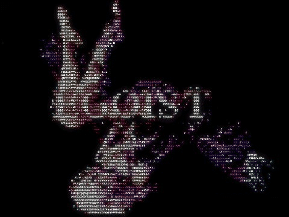

  

---

- **[FrameNote](https://github.com/neartana/frame-note)** — an AI agent skill for watching videos & reels: downloads via self-hosted Cobalt, reads the frames, and saves a Markdown note. `npx skills add neartana/frame-note`
- **[Dohctor](https://github.com/neartana/dohctor)** — a DNS doctor for AI agents: diagnose DNS blocking & poisoning, resolve and fetch over DNS-over-HTTPS. Keyless. `npx skills add neartana/dohctor`
- **[Tracenime](https://github.com/neartana/Tracenime)** — name that anime from a screenshot: series, episode and timestamp via trace.moe + AniList. React · TypeScript · all data stays in your browser
- **[Anigraph](https://github.com/neartana/Anigraph)** — your anime & manga library, in perspective: statistics, recommendations, tier lists and airing schedules for AniList & MyAnimeList users. Vanilla JS · [Live](https://anigraph-phi.vercel.app)
- **[Nai](https://github.com/neartana/Nai)** — the AI that's yours: a personal assistant bubble on every page — chat, voice, page scans and PDFs, with a memory you approve. Manifest V3 · vanilla JS · zero dependencies
- **[nextshift](https://github.com/neartana/nextshift)** — switch AI coding agents without losing the thread: one `/continue` command resumes another agent's work from a shared `.agent/` checkpoint. `npx github:neartana/nextshift`
- **[bluearchive-persona](https://github.com/neartana/bluearchive-persona)** — turn Muse into a Blue Archive student: a step-by-step tutorial in real chat order — .glb avatar, researched persona, rename

