  

  <strong>Indie builder from Bekasi, Indonesia 🇮🇩</strong> 
  I build tools for AI agents — and small web apps with strong design opinions. 
  Everything here is open source (MIT), and most of it installs in one line.

---

<h2 align="center">The series</h2>

One name pinned at the top; the work changes underneath.

<table align="center">
  <tr>
    <td align="center" width="33%">
       
      <strong><a href="https://github.com/neartana/frame-note">FrameNote</a></strong> 
      Your agent can't watch videos — FrameNote teaches it to read them: frame by frame, note by note. 
      <code>npx skills add neartana/frame-note</code>
    </td>
    <td align="center" width="33%">
       
      <strong><a href="https://github.com/neartana/dohctor">Dohctor</a></strong> 
      A DNS doctor for AI agents — diagnose DNS blocking &amp; poisoning, resolve and fetch over DNS-over-HTTPS. Keyless. 
      <code>npx skills add neartana/dohctor</code>
    </td>
    <td align="center" width="33%">
       
      <strong><a href="https://github.com/neartana/Tracenime">Tracenime</a></strong> 
      Point at any anime screenshot — Tracenime names the series, episode and timestamp. Brutalist Kinetic Orange, all data stays in your browser.
    </td>
  </tr>
</table>

---

<h2 align="center">More builds</h2>

- **[manga-translator](https://github.com/neartana/manga-translator)** — one-click manga/comic page translator: detects bubble text, removes it, translates, re-letters the page.
- **[Cursor-Ready](https://github.com/neartana/Cursor-Ready)** — a SaaS app starter, ready to build on.

<h2 align="center">Toolbox</h2>

  
  
  
  
  
  
  

<h2 align="center">Numbers</h2>

  
  

---

  Building in public from Bekasi. If a tool here saves you time, a ⭐ is the cheapest thank-you. 
  Hero: “AEAX” in pale blocks on a dark grid — every few seconds it bursts into red/cyan glitch slices. Every project logo below is my own.

